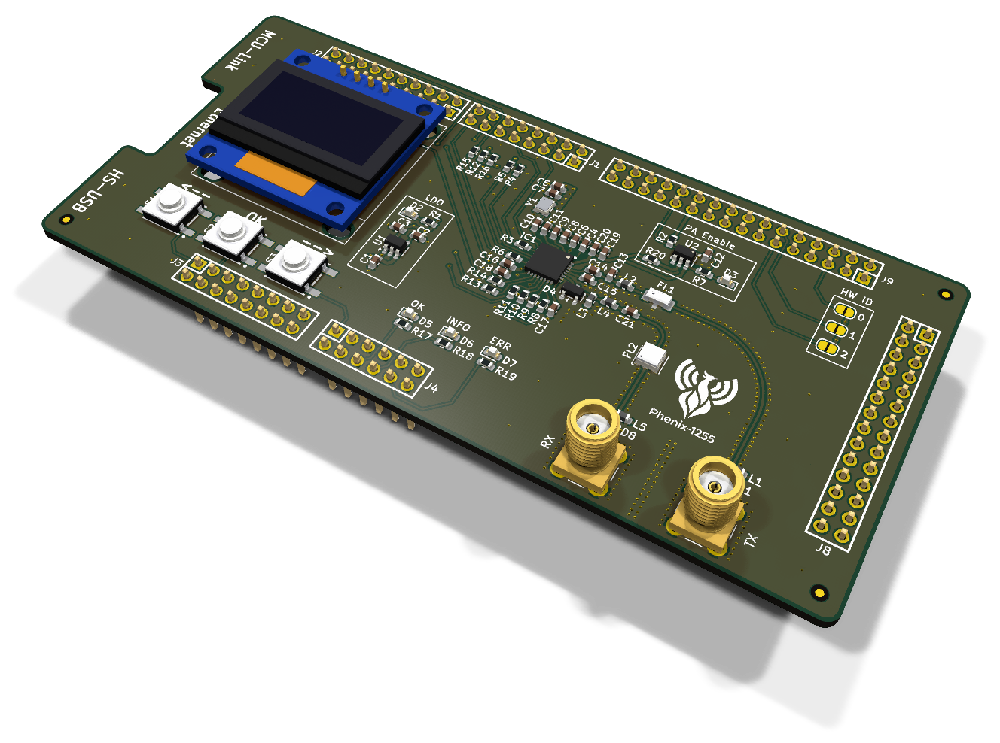
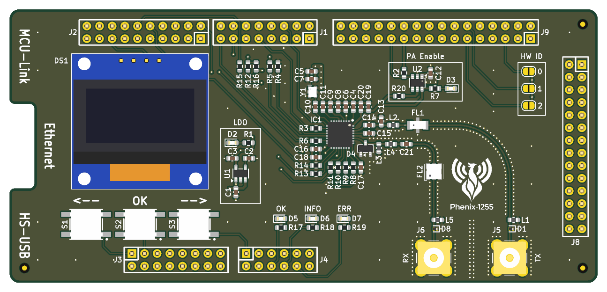
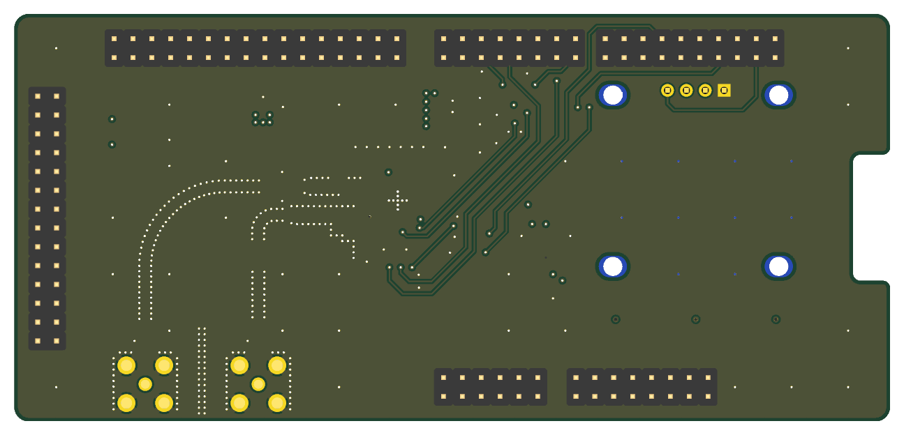

# phenix-1255-shield-v2

Expansion board (shield) for the NXP **FRDM-MCXN947** development board, built around the Semtech **SX1255** RF transceiver (TX 440 MHz, RX 430 MHz).

Together with the firmware it turns the FRDM board into a multimode SDR transceiver for base stations: TETRA today, DMR, FM and more modes planned. The I/Q samples are streamed to a host over HS USB or Ethernet.

This board is the hardware part of [phenix-1255-sw](https://github.com/w4tchd0g/phenix-1255-sw). It is **revision V2** of [phenix-1255-shield](https://github.com/w4tchd0g/phenix-1255-shield), see [Changes from V1](#changes-from-v1). Both are modified versions of [Phenix-1255-HW](https://github.com/labdvm/Phenix-1255-HW) by Z32IT ([@labdvm](https://github.com/labdvm)), see [Changes from Phenix-1255-HW](#changes-from-phenix-1255-hw).

> **Status:** V2 design complete, not yet built. The schematic passes ERC without errors, the PCB passes DRC without errors and without unrouted connections. The changes from V1 are checked by ERC/DRC and by calculation only; they still need a test on real boards. The Gerber, BOM and position files for JLCPCB and PCBWay are in [`production/`](#fabrication). Before the first power-up, read the [bring-up checklist](#bring-up-checklist).

## Preview



| Top | Bottom |
|---|---|
|  |  |

## Changes from V1

V2 continues [phenix-1255-shield](https://github.com/w4tchd0g/phenix-1255-shield) (V1). The circuit concept, the MCU pin assignment and the board outline are unchanged, so V1 firmware runs on V2 without changes (V2 also reports [hardware ID 0](#assembly-notes)). The changes (2026-11) are:

**RF front end**

- **RX SAW filter:** Murata (RFMi) SF2446E (435 MHz, 23 MHz 3 dB bandwidth, SM3030-6, LCSC C3283586) instead of the Tai-Saw TA0655A (430 MHz, 4 MHz passband). JLCPCB places it; the TA0655A had to be soldered by hand. The SF2446E does not reject the TX signal at 440 MHz; for duplex operation an external duplexer at J5/J6 provides the TX/RX isolation.
- **Matching networks recalculated with the layout parasitics:** the short tracks and pads at the 100 Ω and 200 Ω nodes add about 1.2 pF each. **C13 = 2.2 pF** instead of 3.6 pF (TX return loss 40.6 dB instead of 14.6 dB) and **L3 = 43 nH** instead of 68 nH (RX match centred on the expected 6–8 pF at RF_IN instead of 5.24 pF). See [RF matching networks](#rf-matching-networks).
- **SMA jacks:** vertical through-hole jacks Kinghelm KH-SMA-KE-Z (gold-plated, LCSC C504007) instead of the hybrid land pattern for either a vertical SMD jack (TE CONSMA001-SMD-G) or an edge-mount jack (Samtec SMA-J-P-H-ST-EM1). The four GND posts are soldered through all four GND layers and take the tightening torque; JLCPCB solders the jacks. Return loss at the ports about 33–35 dB.
- **Jack position:** the jacks sit 0.64 mm further from the board edge (centre 5.04 mm from the edge), L1/D1 and L5/D8 1.27 mm further. FL2 sits as far from the bend of the RX line as C21.

**Power**

- **R20 (0 Ω) between QOD and VOUT of the PA load switch U2:** in V1, QOD was tied directly to VOUT. With R20 fitted the behaviour is the same as in V1 (VBAT3 is actively discharged while the PA is off). Without R20, VBAT3 floats like in Phenix-1255-HW. This allows testing whether the SX1255 tolerates the discharged VBAT3 (see [bring-up checklist](#bring-up-checklist)).

**PCB and assembly**

- **SX1255 exposed pad:** 9 thermal vias arranged as a cross instead of a 3 × 3 grid, so that the paste can be 4 regular squares (57 % of the land) instead of 8 irregular openings.
- **Fiducials:** three fiducials (FID1–FID3) for machine assembly.
- **Assembly:** JLCPCB now places FL2 and J5/J6 as well. Only the display and the FRDM headers are soldered by hand.
- **Ground stitching:** via fences adapted to the new positions, 319 GND vias.
- **Silkscreen:** `RX`/`TX` without the frequency, aligned reference designators, revision V2 in the title blocks.

**Documentation and scripts**

- `scripts/rf_calc.py` models the through-hole SMA launch (axisymmetric field solver) and includes the layout parasitics in the matching networks.
- `scripts/make_3d_models.py` generates the models of the KH-SMA-KE-Z and the SF2446E. The SMA variant images and `scripts/sma_variant.py` are gone.
- The length of the longest RF line is corrected (38.9 mm, about 36° at 440 MHz).

## Changes from Phenix-1255-HW

The basic hardware concept comes from [labdvm/Phenix-1255-HW](https://github.com/labdvm/Phenix-1255-HW) (Copyright © Z32IT 2026, CERN-OHL-P-2.0). This project changes revision V2 of Phenix-1255-HW (not to be confused with revision V2 of this shield) as follows (2026-11):

**RF**

- **Antenna matching:** new matching networks. TX: an L-network transforms the 50 Ω of the LFCN-490+ to the 100 Ω optimum load of RFO_P (before: 100 pF straight to the filter). RX: 100 pF / 33 nH / 43 nH for the 200 Ω LNA input (before: 39 nH series, 82 nH shunt). See [RF matching networks](#rf-matching-networks).
- **RF connectors:** SMA instead of U.FL: vertical through-hole jacks (Kinghelm KH-SMA-KE-Z) at J5/J6. The four GND posts are soldered through all four GND layers, so the jacks take the tightening torque.
- **RX SAW filter:** Murata (RFMi) SF2446E (435 MHz, 23 MHz 3 dB bandwidth, SM3030-6) instead of the Tai-Saw TA0655A (430 MHz, 4 MHz passband), so that JLCPCB can place it.
- **Port protection:** each SMA port has a 100 nH DC shunt and a low-capacitance TVS diode (before: 1 MΩ to GND). A BAV99 limiter protects the RX input of the SX1255.
- **PCB:** 4 layers instead of 2, with 50 Ω coplanar waveguides on a solid GND plane, via fences along the RF lines and a GND stitching grid, see [PCB](#pcb). No mounting holes.
- **Reference clock:** 2520 footprint only, TCXO AC-coupled to XTB through 10 nF (before: direct connection with 10 kΩ / 10 pF to GND).

**Power**

- **3.3 V regulator:** an ST LDK130M33R (SOT-23-5) replaces the Microchip MCP1703A (SOT-223). It runs directly from `+5v0`; the PTC fuse, the TVS array and the ferrite bead at the input are gone.
- **Supply split:** the LDO only supplies the RF part (SX1255, TCXO, PA load switch). Display, buttons and jumpers run from the FRDM 3.3 V rail. The 1 Ω series resistors in the SX1255 supply pins are gone. See [Power](#power).
- **PA supply switching:** an integrated load switch (TPS22917) replaces the P-channel MOSFET. The *bypass* solder jumper is gone.

**Digital interface and MCU pins**

- **`~PA_EN` pin:** moved from P2_4 to P1_23 (J9.23) for better routing.
- **Series resistors:** 33 Ω at the driving end of each SX1255 signal. NSS has a 10 kΩ pull-up, CK_IN and Q_IN are bridged and pulled down with one 10 kΩ resistor, `SX_RST` has no series resistor.
- **Hardware ID:** three solder jumpers (JP1–JP3, `HW_ID_0`…`HW_ID_2`) encode the board version, so that the firmware can support several hardware versions (up to 8). This board is **hardware ID 0** (all jumpers open).
- **Buttons:** Panasonic EVQ-Q2 instead of C&K PTS647. *OK* and *→* swapped pins: *OK* is now on P1_22 (J3.3), *→* on P4_12 (J4.1).
- **Status LEDs:** five instead of four; the new PA LED lights while the PA is powered. The LEDs on the GPIOs were reassigned: P0_14 green *OK* (before: red *Err*), P0_22 yellow *INFO* (before: *Warn*), P0_15 red *ERR* (before: green *Good*). 1 kΩ instead of 1.5 kΩ series resistors.
- **Display:** footprint with the module outline (DS1) instead of a 1×4 socket, without series resistors in SCL/SDA.

See [MCU pin assignment](#mcu-pin-assignment) for the pins. The TX driver amplifier of the *V2 Plus* variant is not part of this design.

## Overview

| | |
|---|---|
| Base board | [NXP FRDM-MCXN947](https://www.nxp.com/design/design-center/development-boards-and-designs/FRDM-MCXN947) |
| Revision | V2 (2026-11-21), successor of [phenix-1255-shield](https://github.com/w4tchd0g/phenix-1255-shield) (V1) |
| EDA tool | KiCad 10 |
| Board size | 118 × 55 mm, R2 corners, 17 × 5 mm cutout (R1 corners) on the left edge for the Ethernet jack of the FRDM board |
| Stackup | 4 layers, 1.6 mm, JLCPCB JLC04161H-7628 |
| Assembly | all parts on the top side; JLCPCB places everything except the display and the FRDM headers (SMA jacks through hole, wave soldering) |
| Based on | [Phenix-1255-HW](https://github.com/labdvm/Phenix-1255-HW) by Z32IT (CERN-OHL-P-2.0), see [Changes from Phenix-1255-HW](#changes-from-phenix-1255-hw) |
| Shield template | FRDM-MCXN947 shield template from [wavenumber-eng/frdm-templates](https://github.com/wavenumber-eng/frdm-templates) (CC0): board outline, header placement and root schematic |

## Components

| Function | Part | Manufacturer |
|---|---|---|
| RF transceiver | SX1255IWLTRT (QFN-32, 5 × 5 mm) | Semtech |
| Reference clock | TG2520SMN 38.4 MHz TCXO (2.5 × 2.0 mm) | Epson |
| SAW filter 435 MHz (RX) | SF2446E (SM3030-6, 3.0 × 3.0 mm, LCSC C3283586) | Murata (RFMi) |
| Low-pass filter (TX) | LFCN-490+ | Mini-Circuits |
| RF connectors (TX, RX) | KH-SMA-KE-Z (SMA jack, vertical, through hole, gold-plated, LCSC C504007) | Kinghelm |
| ESD protection RF ports | PESD5V0F1BL | Nexperia |
| RX input limiter | BAV99 | Nexperia |
| LDO 3.3 V | LDK130M33R | ST |
| PA supply load switch | TPS22917LDBVR (active-low enable) | TI |
| Display | OLED 0.96″ 128×64, SSD1306, I²C, pin order GND/VDD/SCL/SDA (module with on-board pull-ups) | – |
| Tactile switch (SPST-NO, 6.5 × 6 mm, SMD), 3× | EVQ-Q2Y03W | Panasonic |
| Status LEDs 0603, 5× (PWR, PA, OK, INFO, ERR) | 19-21/GHC-YR1S2/4T (green), 19-21/Y2C-CP1Q2B/4T (yellow), 19-21/R6C-FP1Q2L/4T (red) | Everlight |
| Hardware ID, 3× | solder jumper, open (hardware ID 0) | – |
| Headers to the FRDM board | Samtec SSQ (from the template) | Samtec |

Passives are 0603 (resistors UNI-ROYAL `0603WAF…`, capacitors Samsung/Murata/Yageo, RF inductors Murata `LQW18AN…`). The manufacturer part numbers are stored in the `MPN` field of the symbols, the JLCPCB/LCSC part numbers in the `LCSC` field. The display and the headers are not in the JLCPCB library.

## Circuit

### Power

| Net | Source | Loads |
|---|---|---|
| `+5v0` | FRDM header J3.10 | LDO input |
| `+3.3V_LDO` | LDO on the shield (enable tied to `+5v0`) | SX1255 VBAT1/VBAT2, TCXO, load switch input, PWR LED |
| `VBAT3` | load switch, controlled by `~PA_EN` | SX1255 VBAT3 (PA supply), PA LED |
| `+3v3` | FRDM header (J3.4, J3.8, J9.21, J8.1) | display, buttons, HW-ID jumpers, `~PA_EN` pull-up |

The RF part runs from its own low-noise LDO. Only the MCU-side parts use the FRDM 3.3 V rail.

`~PA_EN` is **active low** and pulled up to `+3v3` with 100 kΩ, so the PA supply stays off until the firmware drives the pin low. The load switch uses quick output discharge: QOD connects to VOUT through R20 (0 Ω), so VBAT3 is discharged while the PA is off. Without R20, VBAT3 floats when the switch is off. CT is left open, which gives the fastest turn-on.

### RF

- **TX:** SX1255 RFO_P → matching network (100 pF / 2.2 pF / 18 nH) → LFCN-490+ low-pass → SMA **J5 (TX)**. RFO_N is AC-coupled to GND.
- **RX:** SMA **J6 (RX)** → SF2446E SAW filter → matching network (100 pF / 33 nH / 43 nH) → SX1255 RFI, with a BAV99 limiter at the RFI pin. The SF2446E is wide (23 MHz) and does not reject the TX signal at 440 MHz; for duplex operation an external duplexer connected to J5/J6 provides the TX/RX isolation.
- **SMA ports:** each port has a 100 nH DC shunt to GND (L1/L5) and a low-capacitance TVS diode (D1/D8). They need no further matching: return loss ≥ 24 dB, about 33–35 dB together with the through-hole launch of the jack (about 0.64 pF, which partly cancels the 100 nH).
- **RF lines:** 50 Ω coplanar waveguide with ground (CPWG) on F.Cu over the solid GND plane In1, 0.30 mm track, 0.30 mm gap (0.20 mm inside the SX1255 courtyard). A field-solver check gives about 52 Ω with solder mask, i.e. a return loss of about 33 dB. The lines are electrically short (longest RF net 38.9 mm ≈ 36° at 440 MHz).
- **Reference clock:** the 38.4 MHz TCXO drives XTB through 10 nF, XTA is left open (TCXO connection per the datasheet). 38.4 MHz is above the specified FXOSC range of the SX1255 (32 / 36 / 36.864 MHz min/typ/max, datasheet Rev. 3.0, table 5). It has been **tested and works**; keep in mind that it is outside the specification. All frequencies derived from FXOSC (PLL step, I/Q sample rate) scale with 38.4 MHz.

`scripts/rf_calc.py` reproduces all RF numbers in this README (CPWG impedance, SMA launch, port shunts, matching networks). It runs with the standard library; the field solver part also needs numpy and scipy (`pip install numpy scipy`).

### RF matching networks

The networks adapt the SX1255 impedances to the 50 Ω of the LFCN-490+ and the SF2446E. They are based on the SX1255 datasheet (Rev. 3.0) and on separate front-end design notes (*SX1255 RF front end: TX 440 MHz / RX 430 MHz*, not in this repository). The values include the parasitic capacitance of the layout at the high-impedance nodes (tracks and pads, estimated with the field solver) and the ESL of C13. They are **start values**; the final tuning is done on the board with a VNA.

#### TX: 100 Ω → 50 Ω

```
RF_OP ──C14 100p──┬──L2 18n──► LFCN-490+ (50 Ω) ──► J5
                  │
               C13 2.2p
                  │
                 GND
RF_ON ──C15 100p── GND
```

The datasheet specifies an optimum load of **100 Ω differential** between RF_OP and RF_ON (section 3.4.4, peak output power +5 dBm). The output is used single-ended: C15 ties RF_ON to ground for RF, so RF_OP has to see 100 Ω. The low-pass L-network (Q = 1) transforms 50 Ω up to 100 Ω:

| Element | Calculated | Used |
|---|---|---|
| Shunt C | 3.62 pF | **C13 = 2.2 pF** (C0G, ±0.25 pF) + 1.20 pF layout (C13 node 0.71 pF, RFO_P node 0.49 pF) + ESL ≈ 3.42 pF |
| Series L | 18.09 nH | **L2 = 18 nH** (wirewound, ±2 %) |

C14 (100 pF) only blocks DC. With the values used, RF_OP sees 99.2 + j1.7 Ω at 440 MHz (return loss 40.6 dB, ≥ 23 dB from 400 to 480 MHz, ≥ 24.9 dB from 430 to 450 MHz within the component tolerances). The previous C13 = 3.6 pF ignored the layout capacitance and would give only 14.6 dB. The network adds 3.1 dB attenuation at the 2nd and 9.5 dB at the 3rd harmonic on top of the LFCN-490+.

**Tuning element: C13.** The output capacitance of RF_OP is not specified and appears in parallel with C13. Trim C13 for maximum output power at J5 (keep 1.8 / 2.0 / 2.4 pF at hand).

#### RX: 50 Ω → 200 Ω

```
J6 ──► SF2446E (50 Ω) ──C21 100p──L4 33n──┬────────┬────────┬──► RF_IN (200 Ω)
                                          │        │        │
                                        L3 43n   D4 BAV99  C_pin (LNA input)
                                          │        │        │
                                         GND      GND      GND
```

RF_IN is a common-gate LNA with an input impedance of 50 Ω or 200 Ω, selected with the bit LnaZin in RegRxAnaGain (section 3.6.2). The network is designed for **200 Ω** (see [Firmware notes](#firmware-notes)).

The ideal L-network at 430 MHz is a series L of 32.05 nH (**L4 = 33 nH**) and a shunt C of 3.21 pF at RF_IN. There is no shunt capacitor on the board: that capacitance comes from the RF_IN node itself (LNA input, BAV99, pads, track). It is larger than needed, and **L3 (43 nH)** compensates the excess (43 nH cancels 3.19 pF at 430 MHz). L3 also gives RF_IN a DC path to ground. The values used require a **total capacitance of 6.41 pF at RF_IN**. Expected: about 4.5 pF for the chip and its connection (implied by the reference values 39 nH / 82 nH without limiter), up to 3 pF for the BAV99 (Nexperia: ≤ 1.5 pF per diode, two in antiparallel) and 1.22 pF for the 7.3 mm track and the pads of this layout, i.e. about 6–8 pF. The datasheet does not specify the LNA input capacitance, so this remains the critical assumption of the RX match (L3 was 68 nH before, designed for 5.24 pF):

| Total capacitance at RF_IN | Return loss at 430 MHz | Best match at |
|---|---|---|
| 5.0 pF | 8.8 dB | 494 MHz |
| 5.5 pF | 12.0 dB | 470 MHz |
| 6.0 pF | 17.9 dB | 449 MHz |
| **6.41 pF** | **29.2 dB** | **433 MHz** |
| 7.0 pF | 17.2 dB | 414 MHz |
| 7.5 pF | 11.7 dB | 398 MHz |
| 8.0 pF | 8.6 dB | 385 MHz |

With the nominal value the return loss is ≥ 20 dB from 420 to 446 MHz, about the 23 MHz 3 dB bandwidth of the SF2446E. The 0.39 pF of the node between C21 and L4 is included.

**Tuning element: L3.** For a match at 430 MHz: 5 pF → 77 nH, 6 pF → 49 nH, 7 pF → 36 nH, 8 pF → 29 nH (keep 39 / 47 nH at hand). Procedure (from the design notes): before the SF2446E is fitted, solder a coax pigtail to its output pad (pin 5) and measure S11 towards the SX1255. If the minimum is above 430 MHz, increase L3; if it is below, decrease L3. Adjust the depth with L4 (27 / 33 / 39 nH). Target S11 ≤ −10 dB, then optimise for best sensitivity.

### Digital interface

All signals between the SX1255 and the headers have 33 Ω series resistors at the driving end: next to the SX1255 for its outputs (`CK_OUT`, `I_OUT`, `MISO`, `DIO0..3`), next to the headers for the MCU outputs (`SCK`, `MOSI`, `NSS`, `I_IN`). NSS has a 10 kΩ pull-up to `+3.3V_LDO`. CK_IN and Q_IN are unused inputs: pins 11 and 12 are bridged next to the SX1255 and pulled down together with one 10 kΩ resistor (R4). Q_OUT and XTA are not connected.

## MCU pin assignment

| Net | Header | FRDM signal | Function |
|---|---|---|---|
| `SCK` | J2.12 | P0_25 / FC1_SCK | SX1255 SPI |
| `MISO` | J2.10 | P0_26 / FC1_SDI | SX1255 SPI |
| `MOSI` | J2.8 | P0_24 / FC1_SDO | SX1255 SPI |
| `NSS` | J1.16 | P0_31 | SX1255 SPI chip select (GPIO) |
| `SX_RST` | J1.6 | P0_29 | SX1255 reset (active high) |
| `DIO0` | J2.2 | P0_28 | SX1255 DIO0 |
| `DIO1` | J1.10 | P0_30 / P4_13 | SX1255 DIO1 |
| `DIO2/WS` | J1.13 | P3_19 / SAI1_RX_FS | SX1255 DIO2, I/Q word select |
| `DIO3` | J2.13 | P0_19 | SX1255 DIO3 |
| `CK_OUT` | J1.9 | P3_18 / SAI1_RX_BCLK | I/Q bit clock from SX1255 |
| `I_OUT` | J1.15 | P3_21 / SAI1_RXD0 | I/Q data SX1255 → MCU |
| `I_IN` | J1.5 | P3_20 / SAI1_TXD0 | I/Q data MCU → SX1255 |
| `~PA_EN` | J9.23 | P1_23 / EZH_LCD_RD | PA supply enable, active low |
| `SDA` | J2.17 | P1_0 | Display I²C |
| `SCL` | J2.15 | P1_1 | Display I²C |
| `BTN_0` | J3.1 | P2_0 | Button S1 (`<--`) |
| `BTN_1` | J3.3 | P1_22 | Button S2 (`OK`) |
| `BTN_2` | J4.1 | P4_12 / P0_21 | Button S3 (`-->`) |
| `LED_0` | J4.6 | P0_14 | LED OK (green) |
| `LED_1` | J4.8 | P0_22 | LED INFO (yellow) |
| `LED_2` | J4.10 | P0_15 (solder jumper SJ8 1-2, FRDM default) | LED ERR (red) |
| `HW_ID_0` | J9.5 | P1_19 / EZH_LCD_D15_CAMERA_RST | Hardware ID bit 0 |
| `HW_ID_1` | J9.12 | P3_4 | Hardware ID bit 1 |
| `HW_ID_2` | J9.11 | P3_5 | Hardware ID bit 2 |

Where the template lists two MCU pins (e.g. `P0_15 / P2_0`), the FRDM board routes the header pin to one of them via a solder jumper or resistor option. The pins above are the defaults from the FRDM-MCXN947 user manual (UM12018 Rev. 2.0). Some MCU pins also reach a second header on the FRDM board; on this shield the second pin is always left unconnected:

- P2_0 (`BTN_0`, J3.1) also goes to J9.25 (R167). It only reaches J4.10 if SJ8 is changed to 2-3, which would short `BTN_0` and `LED_2`. **Leave SJ8 on the FRDM board in its default position 1-2.**
- P1_22 (`BTN_1`, J3.3) also goes to J9.24.
- P1_23 (`~PA_EN`, J9.23) also goes to J1.8 (SJ1 1-2, default).

### Firmware notes

- **Buttons and HW-ID jumpers** switch to `+3v3` and have no external pull-downs. Enable the **internal pull-downs** on `BTN_x` and `HW_ID_x`. A pressed button or a closed jumper reads as `1`.
- **LEDs** `LED_0..2` are active high (1 kΩ to the LED). The PWR LED is always on, the PA LED lights while `VBAT3` is powered.
- **`SX_RST`** must stay **floating** in normal operation, as required by the SX1255 datasheet. Configure the GPIO as an input without pull resistor and drive it high only to reset.
- **`~PA_EN`**: drive it low to power the PA, drive it high or release it to switch the PA off.
- **LNA input impedance**: keep LnaZin (RegRxAnaGain, register 0x0C bit 0, reset value 1) at 1 = 200 Ω. The RX matching is designed for it; 50 Ω detunes the RX input.
- **I/Q interface**: SAI1 receives with the bit clock and frame sync from the SX1255; the transmitter has to run synchronously to the receiver.
- **Reference clock**: FXOSC is 38.4 MHz, not the 36 MHz of the datasheet examples. Calculate PLL and sample-rate settings with 38.4 MHz.

## PCB

### Stackup

JLCPCB JLC04161H-7628, 1.6 mm, 4 layers:

| Layer | Use | Dielectric to next layer |
|---|---|---|
| F.Cu | signals and RF (CPWG), GND fill | 0.21 mm prepreg 7628, εr 4.4 |
| In1.Cu | solid GND plane, no routing | 1.065 mm core, εr 4.6 |
| In2.Cu | power plane (`+3v3`, `+3.3V_LDO` and `+5v0` areas), GND below the RF section | 0.21 mm prepreg 7628, εr 4.4 |
| B.Cu | signals (SPI, DIO, SDA), GND fill | – |

The RF section has no vias in the signal path and no tracks on the inner layers or B.Cu. The GND layers are tied together with via fences along the RF lines and a stitching grid; the SX1255 exposed pad has 9 thermal vias arranged as a cross, with 4 square paste openings (57 % of the land) between them. Three fiducials sit in the corners. Design minimums: 0.15 mm track and clearance, 0.3 mm drill, 0.5 mm via diameter (vias used: 0.6 / 0.3 mm and 0.8 / 0.4 mm).

## Fabrication

Production files are in `production/`:

- `production/phenix-1255-shield-v2-gerber.zip` – upload this to JLCPCB or PCBWay (Gerber X1, Protel extensions, Excellon drill, PTH and NPTH separate).
- `production/gerber/` – the same files unpacked, plus the drill maps.
- `production/phenix-1255-shield-v2-bom.csv` and `production/phenix-1255-shield-v2-cpl.csv` – BOM and position file for JLCPCB assembly (see [Assembly notes](#assembly-notes)).

Order settings:

- **JLCPCB:** 4 layers, 1.6 mm, stackup **JLC04161H-7628** (the RF lines are calculated for it), 1 oz outer copper.
- **PCBWay:** 4 layers, 1.6 mm, 1 oz outer copper. The standard stackup is not guaranteed to match, so specify the [stackup](#stackup) in the order remark: layer order F.Cu (`.gtl`), In1.Cu (`.g1`), In2.Cu (`.g2`), B.Cu (`.gbl`); 0.21 mm prepreg 7628 between F.Cu and In1.Cu. The 50 Ω CPWG on F.Cu (0.30 mm track, 0.30 mm gap to the coplanar GND, reference In1.Cu) depends on that prepreg thickness.

Regenerate the files after every layout change:

```sh
./scripts/gerber.sh   # aborts if the DRC reports errors or unconnected items
./scripts/assembly.sh # BOM and position file for JLCPCB assembly
./scripts/render.sh   # updates the images in docs/img/
```

### Assembly notes

- All parts are on the top side. The SMA jacks J5/J6 are through hole (JLCPCB: wave soldering). Their posts stick out about 2.4 mm below the shield; check that nothing on the FRDM board underneath touches them.
- The display DS1 and the FRDM headers J1–J4, J8 and J9 are marked *Do not populate* in the schematic and on the PCB. `./scripts/assembly.sh` leaves them out of the BOM and the position file. Solder these parts by hand.
- JLCPCB assembly: upload `production/phenix-1255-shield-v2-bom.csv` and `production/phenix-1255-shield-v2-cpl.csv`. The position file contains rotation offsets for the SOT-23 packages (D4, U1, U2) and the SX1255 (IC1). **Check the orientation of D4, U1, U2, IC1, Y1 and FL2 (pin 1 = wide pad) in the JLCPCB placement preview** before ordering.
- Three fiducials (FID1–FID3, 1 mm copper in a 2 mm mask opening) sit in the top-right, bottom-right and bottom-left corners for machine assembly.
- This board is **hardware ID 0**: leave the jumpers JP1–JP3 open. Do not bridge them, otherwise the firmware detects a different hardware version.
- If the RX match is to be measured (see [RF matching networks](#rf-matching-networks)), order the first board without FL2 (set it to *Do not populate*).

## Bring-up checklist

These points cannot be checked on paper and need a measurement on the first board:

- **TX output:** check the single-ended output on RFO_P (no DC feed) against the Semtech reference design, and trim C13 for maximum output power.
- **RX match:** the match assumes 6.41 pF at RF_IN, which the datasheet does not specify. Measure S11 at the SF2446E output (FL2 pin 5) and adjust L3/L4.
- **PA supply:** confirm that the SX1255 tolerates VBAT3 switched off while VBAT1/VBAT2 are powered. With the PA off (`~PA_EN` high), measure VBAT3 against GND (e.g. at C19/C20): a few millivolts are fine; a clearly measurable voltage means current flows through the SX1255 into the 150 Ω discharge of U2. In that case remove R20, then VBAT3 floats.
- **SMA jacks:** the posts stick out about 2.4 mm below the shield. Check on the first board that nothing on the FRDM board touches them.
- **Reference clock:** 38.4 MHz is outside the SX1255 specification (tested and working, see [RF](#rf)).

## Project structure

```
phenix-1255-shield-v2/
├── phenix-1255-shield-v2.kicad_pro    # project file – open this one
├── phenix-1255-shield-v2.kicad_sch    # root schematic: FRDM headers, PWR_FLAGs
├── schematic.kicad_sch             # sub-sheet: SX1255, RF, power, UI
├── phenix-1255-shield-v2.kicad_pcb    # PCB
├── phenix-1255-shield-v2.kicad_dru    # custom design rules (RF, stitching)
├── phenix-1255-shield-v2.kicad_sym    # symbols from the template
├── sym-lib-table / fp-lib-table    # project libraries
├── empty.kicad_wks                 # drawing sheet
├── scripts/gerber.sh               # Gerber and drill files for JLCPCB and PCBWay
├── scripts/assembly.sh             # BOM and position file for JLCPCB assembly
├── scripts/jlc_csv.py              # helper for assembly.sh: JLCPCB column format, rotation offsets
├── scripts/render.sh               # renders the images in docs/img/
├── scripts/trim.py                 # helper for render.sh: crops the images to the board
├── scripts/rf_calc.py              # CPWG impedance, SMA launch and matching network calculation
├── scripts/make_3d_models.py       # generates the simplified 3D models in ext_parts/3d/
├── docs/img/                       # rendered PCB images
├── production/                     # Gerber, drill and assembly files (generated)
├── ext_parts/                      # project-specific symbols, footprints and 3D models
└── LICENSE                         # CERN-OHL-P-2.0
```

## Usage

1. Clone the repository.
2. Open `phenix-1255-shield-v2.kicad_pro` in KiCad 10.

The project-specific libraries are linked relative to the project via `${KIPRJMOD}`. Standard parts and their 3D models come from the KiCad 10 libraries that are installed with KiCad. Nothing else needs to be installed or configured.

**Notes:**

- According to NXP, the connectors in the template are 2–6 mil off from the exact Arduino positions. This is a design bug of the FRDM-MCXN947 itself; the shield still mates with the board.
- Always double-check the header IO assignments against the current FRDM-MCXN947 documentation before ordering boards.

## License

This project (schematics, PCB, the libraries in `ext_parts/`, scripts and documentation) is a modified version of [Phenix-1255-HW](https://github.com/labdvm/Phenix-1255-HW), Copyright © Z32IT 2026 (see [Changes from Phenix-1255-HW](#changes-from-phenix-1255-hw)), and is licensed under the [CERN Open Hardware Licence Version 2 – Permissive](LICENSE) (CERN-OHL-P-2.0), except for the third-party content listed below.

Third-party content:

- **Shield template** ([wavenumber-eng/frdm-templates](https://github.com/wavenumber-eng/frdm-templates), FRDM-MCXN947 KiCad template): board outline, header footprints and their placement, root schematic with the header symbols (`phenix-1255-shield-v2.kicad_sch`, `phenix-1255-shield-v2.kicad_sym`). [CC0 1.0](https://creativecommons.org/publicdomain/zero/1.0/)
- **Display footprint** `Display_128x64_096_I2C`: by TG9541 ([kicad-footprints](https://github.com/TG9541/kicad-footprints)), [CC0 1.0](https://creativecommons.org/publicdomain/zero/1.0/)
- **Standard parts:** footprints and 3D models from the KiCad libraries are referenced, not included (CC-BY-SA 4.0 with the KiCad library exception for designs).

Datasheets are not part of this repository; the `Datasheet` field of each part links to the manufacturer.

This source is distributed **WITHOUT ANY EXPRESS OR IMPLIED WARRANTY, INCLUDING OF MERCHANTABILITY, SATISFACTORY QUALITY AND FITNESS FOR A PARTICULAR PURPOSE**. Please see the CERN-OHL-P-2.0 for applicable conditions.

Source location: <https://github.com/w4tchd0g/phenix-1255-shield-v2>
